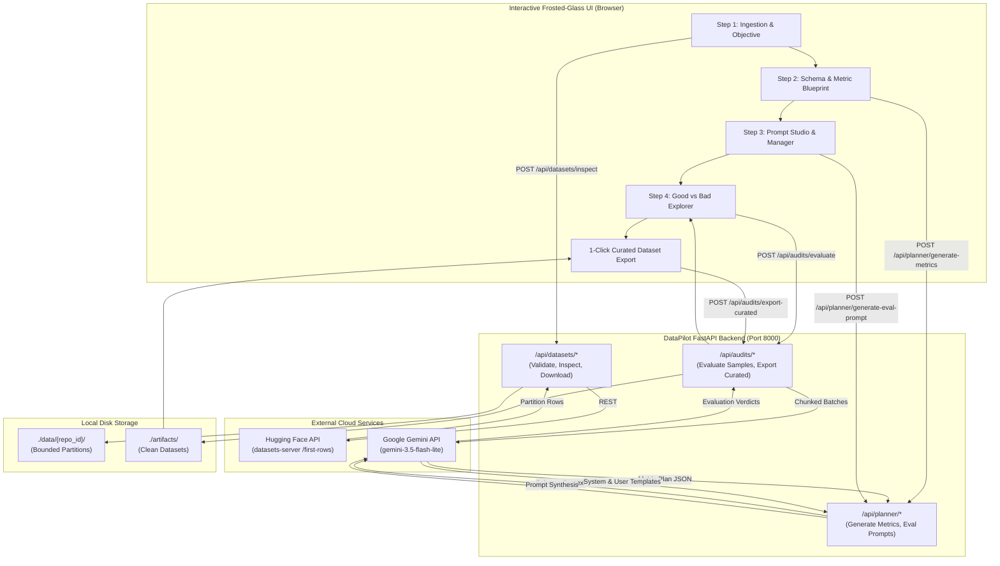
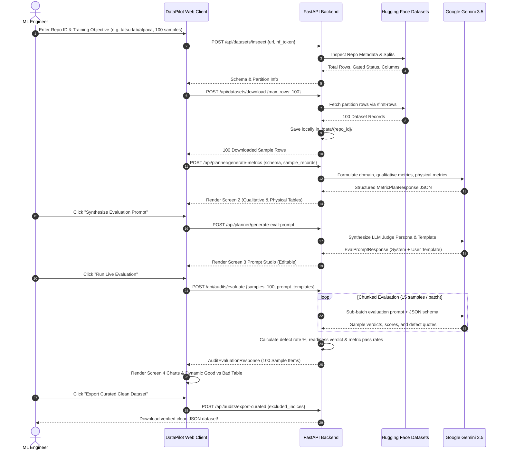

# DataPilot

> **Autonomous Multimodal Dataset Readiness & Quality Auditor for AI Training Pipelines**  
> *Know your data before burning compute. Audit open-source datasets for fine-tuning readiness, catch poison samples, and export clean, curated training seeds.*

---

## Executive Summary & Mission

Training or fine-tuning foundation models on open-source datasets (from Hugging Face or web archives) is fraught with silent risks. Real-world public datasets are frequently contaminated with:
- **Empty or Truncated Responses:** Model learns refusal loops or abrupt cutoffs.
- **Verbatim Instruction Leakage:** Model copies the prompt into the output instead of completing the task.
- **Acoustic Speech Degradation:** Clipped waveforms, excessive dead air (>1.8s), or missing terminal punctuation ruin vocoder and TTS alignment.
- **Context Window Overflow:** Outlier samples exceeding 2,048 tokens that silently get truncated during batched attention computation.
- **Semantic Drift & Hallucination:** Targets that fail to answer the user's specific prompt objective.

**DataPilot** is a local-first, multimodal dataset auditor designed to solve this dilemma. It combines **deterministic physical signal checks** with **Google Gemini 3.5 LLM-as-a-Judge semantic reasoning** to determine whether open-source datasets are genuinely suitable for training.

```
       ┌────────────────────────────────────────────────────────┐
       │                 THE DATAPILOT PROMISE                  │
       │                                                        │
       │  "Never feed unverified data into a training run.       │
       │   Audit first. Filter out defects. Train with Golden." │
       └────────────────────────────────────────────────────────┘
```

---

## Key Features

| Capability | Description |
| :--- | :--- |
| **Multimodal Auditing** | Supports both **NLP Text** (SFT Instruction Tuning, Q&A Reasoning, Classification) and **Acoustic Audio** (Speech TTS, Voice Synthesis, Utterance Transcripts). |
| **Autonomous Metric Planning** | Gemini 3.5 analyzes your dataset schema and training objective to generate bespoke **Qualitative Rubrics** and **Physical Threshold Blueprints** without human bias. |
| **Transparent Prompt Studio** | Review and edit the synthesized LLM-as-a-Judge system prompt and user template before evaluation. Context chips keep metrics visible. |
| **Resilient Chunked Evaluator** | Batch-evaluates samples in sub-chunks of 15 records to prevent token overflow, accompanied by a multi-stage self-healing JSON parser. |
| **Dynamic Good vs Bad Explorer** | Real-time Doughnut & Bar charts, 1-click partition filters (All Samples, Defective, Needs Curation, Golden Pass), and deep diagnostic inspection drawer. |
| **1-Click Clean Dataset Export** | Toggle exclusions on anomalous samples and download verified, production-ready curated datasets in standard JSON format. |

---

## System Architecture

DataPilot operates on a decoupled client-server architecture:
- **Frontend:** Lightweight, zero-dependency HTML5/CSS3/Vanilla ES6+ web interface with interactive physics and Chart.js visualizations.
- **Backend:** High-performance **FastAPI** Python application orchestrating Hugging Face datasets-server streaming and Google Gemini API evaluations.



---

## End-to-End Request-Response Sequence



---

## User Interface Walkthrough

Below is the complete end-to-end video demonstration of the DataPilot user interface, showcasing dataset ingestion, schema profiling, AI metric blueprint synthesis, Prompt Studio customization, live chunked sample evaluation, and curated dataset export:

<video src="assets/videos/datapilot_demo.mp4" controls="controls" width="100%">
  Your browser does not support the video tag. You can view or download the walkthrough video directly: <a href="assets/videos/datapilot_demo.mp4">assets/videos/datapilot_demo.mp4</a>
</video>

*Direct link to demonstration video:* [assets/videos/datapilot_demo.mp4](assets/videos/datapilot_demo.mp4)

---

## Quickstart & How to Run

### 1. Prerequisites
- **Python:** 3.10 or higher
- **Modern Browser:** Chrome, Edge, Firefox, or Safari
- **API Keys:**
  - [Google Gemini API Key](https://aistudio.google.com/app/apikey) (Free tier supported)
  - [Hugging Face Token](https://huggingface.co/settings/tokens) (Optional, for gated datasets like Common Voice)

### 2. Clone and Setup
```bash
# Clone the repository
git clone https://github.com/shashi3002/datapilot.git
cd datapilot

# Create a virtual environment
python -m venv venv

# Activate the virtual environment
# Windows (PowerShell):
.\venv\Scripts\Activate.ps1
# Linux / macOS:
source venv/bin/activate

# Install required dependencies
pip install -r requirements.txt
```

### 3. Configure Environment Variables
Copy `.env.example` to `.env` and insert your credentials:
```bash
cp .env.example .env
```
Edit `.env`:
```env
# Hugging Face Access Token
HF_TOKEN=hf_your_token_here

# Google Gemini API Key
GEMINI_API_KEY=your_gemini_api_key_here
GEMINI_MODEL=gemini-3.5-flash-lite
```

> [!IMPORTANT]
> The `.env` file is explicitly ignored in `.gitignore`. Never commit your API keys to version control!

### 4. Start the Application

Start the FastAPI backend with hot-reload enabled:
```bash
uvicorn app.main:app --reload --port 8000
```

Verify backend health:
```bash
curl http://127.0.0.1:8000/api/health
# Response: {"status":"healthy","version":"1.0.0","service":"DataPilot Backend"}
```

### 5. Launch the Web Interface
You can access the UI in two ways:
1. **Via Backend:** Open `http://localhost:8000` in your browser.
2. **Direct File Open:** Double-click `app/static/index.html` directly in your file explorer. DataPilot dynamically binds to `http://127.0.0.1:8000` regardless of origin.

---

## Running Automated Tests

Run the end-to-end API test suite using `pytest`:
```bash
# Ensure virtual environment is active
pytest -v tests/test_api_endpoints.py
```

The test suite validates:
- `GET /api/health` service status.
- `POST /api/datasets/validate-url` security and input sanitization.
- `POST /api/datasets/inspect` schema reflection.
- `POST /api/datasets/download` bounded partition caching.
- `POST /api/planner/generate-metrics` AI rubric planning.
- `POST /api/planner/generate-eval-prompt` LLM judge prompt assembly.

---

## REST API Reference

| Endpoint | Method | Request Payload | Description |
| :--- | :---: | :--- | :--- |
| `/api/health` | `GET` | *None* | Heartbeat and service health ping. |
| `/api/datasets/validate-url` | `POST` | `{"url": "str"}` | Validates HF URL syntax and sanitizes malicious characters. |
| `/api/datasets/inspect` | `POST` | `{"url": "str", "hf_token": "opt"}` | Inspects repository metadata, splits, and schema. |
| `/api/datasets/download` | `POST` | `{"url": "str", "max_rows": 100}` | Downloads and locally caches bounded sample partitions. |
| `/api/planner/generate-metrics`| `POST` | `{"training_objective": "str", "schema_definitions": {}, "sample_records": []}` | Generates qualitative and physical audit blueprints via Gemini. |
| `/api/planner/generate-eval-prompt` | `POST` | `{"training_objective": "str", "qualitative_metrics": []}` | Synthesizes LLM-as-a-Judge system & user prompts. |
| `/api/audits/evaluate` | `POST` | `{"samples": [], "eval_system_prompt": "str", "eval_user_prompt_template": "str"}` | Runs chunked evaluation across samples and compiles stats. |
| `/api/audits/export-curated` | `POST` | `{"repo_id": "str", "samples": [], "excluded_indices": []}` | Drops defective records and returns clean training dataset. |

---

## Project Repository Structure

```
datapilot/
├── .env.example              # Credentials & configuration template
├── .gitattributes            # Git LFS tracking for large video assets
├── .gitignore                # Strictly excludes .env, data/, and caches
├── requirements.txt          # Python production & test dependencies
├── README.md                 # Complete documentation & architectural guide
├── Dockerfile                # Production container deployment specification
├── Procfile                  # Cloud deployment runtime command
├── render.yaml               # 1-click cloud service blueprint
│
├── assets/                   # Project Media & Visual Assets
│   └── videos/
│       └── datapilot_demo.mp4 # Full UI demonstration recording
│
├── app/                      # Application Source Code
│   ├── main.py               # FastAPI entrypoint & router mounts
│   ├── config.py             # Settings, paths, and environment loader
│   │
│   ├── api/                  # REST API Route Controllers
│   │   ├── audits.py         # /api/audits endpoints (evaluate & export)
│   │   ├── datasets.py       # /api/datasets endpoints (inspect & download)
│   │   └── planner.py        # /api/planner endpoints (metrics & prompts)
│   │
│   ├── services/             # Core Business Logic & AI Engines
│   │   ├── evaluator.py      # Chunked LLM-as-a-Judge & fallback heuristics
│   │   ├── gemini_service.py # Gemini 3.5 Flash Lite client & normalizers
│   │   └── hf_service.py     # Hugging Face datasets-server streaming
│   │
│   └── static/               # Client-Side Web UI
│       ├── index.html        # 4-Screen Frosted Glass Layout
│       ├── styles.css        # Minimalist aesthetic & interactive waves
│       └── app.js            # Reactive state, charts, and API orchestrator
│
└── tests/                    # Verification & Automated Test Suites
    └── test_api_endpoints.py # End-to-end API route tests
```

---

## Contributing

Contributions are welcome! If you want to add new modality evaluators (e.g., Computer Vision / Video), deterministic physical metric calculators, or new LLM backends:
1. Fork the Project.
2. Create your Feature Branch (`git checkout -b feature/NewModality`).
3. Commit your Changes (`git commit -m 'Add Vision readiness auditor'`).
4. Push to the Branch (`git push origin feature/NewModality`).
5. Open a Pull Request.

---

## License

Distributed under the Apache 2.0 License. See `LICENSE` for more information.
